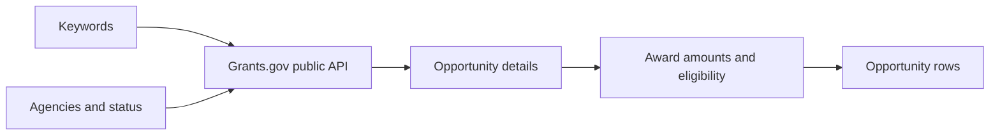

# Grants.gov Scraper: Federal Grant Opportunities and Funding

[](https://apify.com/Turboextract/grants-gov-opportunities)
[](LICENSE)
[](#pricing)

**Export US federal grant opportunities from Grants.gov by keyword, agency or status, with opportunity number, agency, open and close dates, award ceiling and floor, total funding, number of awards, eligible applicants, funding category, description and agency contact.** Find grants to apply for or track federal funding. No API key.

In one test, 50 open opportunities from 11 agencies came back in 24 seconds. 17 list an award ceiling, and together they report $132M in estimated total funding.

**Try it now →** [apify.com/Turboextract/grants-gov-opportunities](https://apify.com/Turboextract/grants-gov-opportunities)

---

## Why this exists

- Grants.gov search has no bulk export with award amounts.
- Award ceiling, eligibility and contacts sit on separate detail pages.
- Grant databases charge $100+ a month.
- Grant writers need open opportunities and close dates in one sheet.

---

## Who this is for

- **Grant writers and consultants** finding new opportunities for clients
- **Nonprofits** tracking grants they are eligible for
- **Universities and researchers** watching NSF, NIH and DOE funding
- **Small businesses** looking for SBIR and federal programs
- **GovTech and sales teams** following where federal money goes

---

## What you get

```json
{
  "opportunityId": "355824",
  "opportunityNumber": "MP-CPI-25-001",
  "title": "Making America Healthy Again by Addressing Dementia Disparities",
  "url": "https://www.grants.gov/search-results-detail/355824",
  "agency": "Office of the Assistant Secretary for Health",
  "agencyCode": "HHS-OPHS",
  "status": "forecasted",
  "openDate": "2024-08-01",
  "closeDate": null,
  "awardCeiling": 600000,
  "awardFloor": 450000,
  "estimatedTotalFunding": 5000000,
  "expectedNumberOfAwards": 9,
  "fundingInstruments": [
    "Grant"
  ],
  "fundingCategories": [
    "Health"
  ],
  "eligibleApplicants": [
    "State governments",
    "Native American tribal organizations (other than Federally recognized tribal governments)",
    "Public housing authorities/Indian housing authorities"
  ],
  "description": "The Office of Minority Health announces the anticipated availability of funds for Fiscal Year (FY) 2025 under the authority of 42 U.S.C. § 300u-6 (Section 1707 of the Public Health Service Act) for demonstration proje..."
}
```

The sample is shortened. Rows also include eligibility notes, archive date, fiscal year, agency contact and a more info link.

---

## How it works



---

## Quick start

1. Click **Try for free**.
2. Add **Keywords**, like `artificial intelligence` or `housing`, or leave empty for all.
3. Optional: add **Agency codes**, like `NSF` or `HHS`.
4. Pick **Status**: Posted and forecasted, Posted, Forecasted, Closed or Archived.
5. Click **Start**, then export to CSV, JSON, Excel or Google Sheets.

### API

```bash
curl -X POST "https://api.apify.com/v2/acts/Turboextract~grants-gov-opportunities/run-sync-get-dataset-items?token=YOUR_TOKEN" \
  -H "Content-Type: application/json" \
  -d '{"keywords": ["climate"], "status": "posted", "maxResults": 100}'
```

### Python

```python
from apify_client import ApifyClient

client = ApifyClient("YOUR_TOKEN")
run = client.actor("Turboextract/grants-gov-opportunities").call(run_input={"agencies": ["NSF"], "maxResults": 200})
for row in client.dataset(run["defaultDatasetId"]).iterate_items():
    print(row["title"], row["closeDate"], row["awardCeiling"])
```

---

## Input fields

| Field | Default | What it does |
|---|---|---|
| `keywords` | – | Words to search opportunities |
| `agencies` | – | Only these agency codes |
| `status` | open | Posted and forecasted, posted, forecasted, closed, archived |
| `postedWithinDays` | 0 | Only opportunities posted in the last N days |
| `includeDetails` | true | Adds award amounts, eligibility, description, contact |
| `maxResults` | 50 | Total cap per run |

---

## Pricing

**$0.001 per opportunity delivered.** 1,000 opportunities cost $1.

| Option | 1,000 opportunities |
|---|---|
| **Grants.gov Scraper** | **$1** |
| Grant database subscriptions | $100+ a month |

---

## Common use cases

- **Weekly grant alerts**: new opportunities for your keywords every Monday
- **Pipeline sheets**: open grants with close dates and award amounts
- **Agency tracking**: everything NSF, NIH or DOE posts
- **Client matching**: filter by eligible applicant type
- **Funding research**: total funding by agency and category

---

## Tips for best results

- Agency codes match Grants.gov, like `NSF`, `HHS`, `DOE`, `USDA` or `DOD`. Sub-agencies such as `HHS-NIH11` work too.
- Forecasted opportunities are announced but not open yet, so close dates are often empty.
- Turn off **Include award amounts** for a fast list of titles and dates.
- Schedule a daily run with **Posted within days** set to 1 for alerts.

---

## Pairs well with

- [Federal Register Scraper](https://apify.com/Turboextract/federal-register-documents): new US rules and notices
- [Federal Contract Winners](https://apify.com/Turboextract/federal-contract-winners): who wins federal contracts
- [EU Tender Alerts](https://apify.com/Turboextract/eu-tender-alerts): public tenders in Europe

---

## FAQ

**Do I need a Grants.gov account?** No. The actor uses Grants.gov's public search API.

**Why is the award ceiling empty?** The agency did not list one, or wrote "none".

**Can I apply through the actor?** No. Each row links to the Grants.gov page where you apply.

**How fresh is the data?** The actor reads Grants.gov live on every run.

**Is it legal?** Grants.gov data is public US government information.

---

## SEO keywords

Grants.gov scraper, federal grants API, grant opportunities list, government funding database, NSF grants export, nonprofit grant finder, grant alerts, federal funding opportunities CSV, SBIR grants search

---

## Support

- Actor page: https://apify.com/Turboextract/grants-gov-opportunities
- Issues and questions: open an issue in this repo
- Community Discord: https://discord.gg/8SrXSCpvgj

Built and maintained by [Turboextract](https://apify.com/Turboextract) on the Apify platform.

---

## License

The documentation and examples in this repository are MIT licensed. The actor itself runs on the Apify platform.
